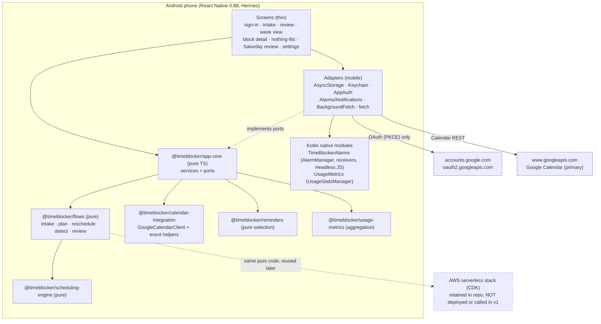
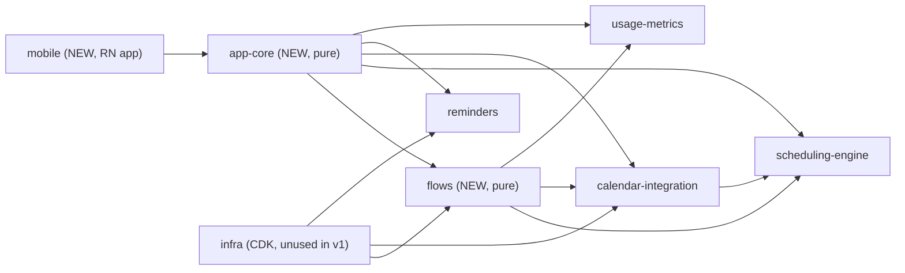
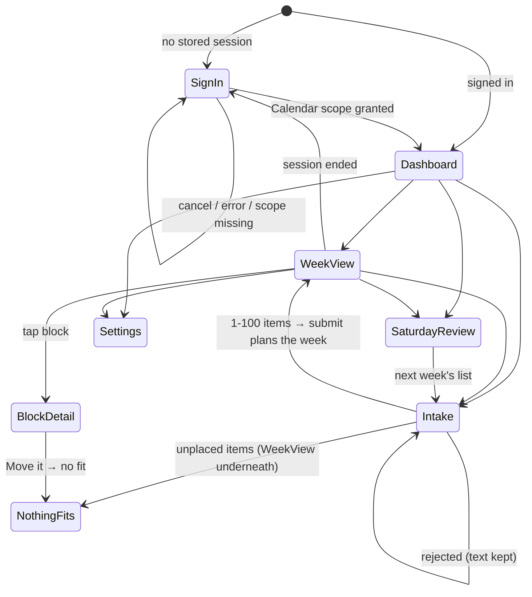

# Design Document

## Overview

TimeBlocker is a single-user React Native app (Android-only in v1) that converts a pasted/typed to-do list into color-coded Google Calendar time blocks, then watches calendar changes and on-device phone usage to proactively reschedule blocks within the same Sunday-Saturday week.

**v1 personal mode runs entirely on the phone (R11-R14).** The Android app performs Google OAuth itself (PKCE, no client secret), keeps tokens in Android Keystore-backed storage, stores items/blocks/settings/reviews locally, computes planning, rescheduling, reminder selection, and the Saturday review on the device, schedules its own local notifications, and syncs directly with Google Calendar. It makes no calls to AWS or to any TimeBlocker backend (R12.8), and depends only on free tooling (R12.10).

**The AWS serverless backend is retained for later but unused in v1.** The CDK stack, Lambdas, DynamoDB tables, and EventBridge schedules described below stay in the repo, keep their tests, and are not deployed for personal mode. The pure orchestration logic they contain (intake parsing, planning, reschedule, conflict detection, weekly review) is extracted into a shared pure package so the phone and the (future) backend run the same code.

In v1 the intake is a pure parser (no Amazon Bedrock, no ML model): the to-do list is a JSON item array (or a `{items:[...]}` object), or plain text lines, parsed directly. When the backend is used later, Google OAuth tokens are stored in the DynamoDB settings table (encrypted at rest), not in Secrets Manager. The backend therefore has no Bedrock and no Secrets Manager charges. See the Future / AI roadmap below for where a generative model would be reintroduced.

All scheduling is computed in **America/Toronto**, never the device timezone. The core scheduling logic is isolated in a pure, deterministic, unit-tested package with no network or I/O so every constraint can be tested in isolation. The same principle extends to the app: all app logic lives in a pure, Node-testable "app core" behind ports, and screens and native modules are thin adapters.

## Architecture

### v1 personal mode (on-device, R11-R14)



The only network destinations in personal mode are Google's OAuth and Calendar hosts (R12.3, R12.8). Usage data never leaves the device (R12.9).

### Backend mode (retained for later, unused in v1)

```
┌─────────────────────────────────────────────┐
│ React Native app (Android-first)             │
│  Screens: sign-in, paste/type intake, item    │
│  review, week view, block detail, Saturday    │
│  review, settings                             │
│  ┌──────────────────────────────────────┐    │
│  │ Android native module                 │    │
│  │  - UsageStatsManager aggregation       │    │
│  │  - actionable-notification handler     │    │
│  └──────────────────────────────────────┘    │
└───────────────┬───────────────────────────────┘
                │ HTTPS (summary signals only)
┌───────────────▼───────────────────────────────┐
│ AWS serverless (CDK)                           │
│  API Gateway → Lambda                          │
│   intake · planning · reschedule · cal-sync    │
│  DynamoDB: items, blocks, settings, reviews    │
│   (settings table also holds Google OAuth      │
│    tokens, encrypted at rest)                  │
│  Intake: pure parser (no Bedrock in v1)        │
│  EventBridge Scheduler: 15-min reminders,       │
│    Sunday nudge, Saturday review               │
└───────────────┬───────────────────────────────┘
                │ OAuth (Calendar scopes)
┌───────────────▼───────────────────────────────┐
│ Google Calendar (primary)                      │
└────────────────────────────────────────────────┘
```

## Components and Interfaces

### Client (React Native + Android native module)

- **Screens:** sign-in, home dashboard, paste/type intake (a text box the user pastes JSON into or types one item per line; submitting plans the week in one step), week view, block detail, Saturday review, settings (distraction apps, holidays, planning mode). The full on-device design is in [On-Device App (v1 Personal Mode)](#on-device-app-v1-personal-mode).
- **Android native module:**
  - Reads screen time and per-app usage via `UsageStatsManager` (after permission).
  - Aggregates usage on-device; emits only summary signals.
  - Handles actionable notifications ("I'm in" / "Skip" / "Move it", and "Will you miss this?" Yes/No).

### Backend (AWS serverless, CDK) — retained, unused in v1

- **API Gateway + Lambda** for four responsibilities: intake, planning, reschedule, and calendar sync.
- **DynamoDB** for items, blocks, settings, and weekly review data.
- **Intake parsing** is a pure function (no Bedrock in v1): it accepts a JSON item list or plain text lines and normalizes each item's duration/priority/category.
- **EventBridge Scheduler** for 15-minute reminders, the Sunday planning nudge, and the Saturday review.
- **DynamoDB settings table** for Google OAuth tokens (encrypted at rest; no Secrets Manager).

After the extraction described in [Package layout and code reuse](#package-layout-and-code-reuse), the Lambda handlers import their orchestration from `@timeblocker/flows`; their behavior and tests are unchanged.

### Scheduling engine (pure, deterministic, unit-tested, no network)

```
weekBounds(date): { sunday, saturday }
  Returns the Sunday and Saturday bounds for any date (America/Toronto).

freeWindows(week, busyEvents, constraints, now): FreeWindow[]
  Builds free time from the schedulable windows by subtracting fixed
  constraints (R3) and real calendar events. Drops gaps < 15 min.

place(items, freeWindows, mode): { placed, unplaced }
  Priority-first placement. mode ∈ { "earliest-fit", "spread" }.
  Enforces one-workout-per-day, Friday-night rules, morning routine.

reschedule(block, week, busy, constraints, options?): Slot | "no-fit"
  Finds the next valid slot in the same Sunday-Saturday week, or
  returns "no-fit" when none exists. New optional options.notBefore
  (ISO instant) lets the device search from max(block.start, now) so
  a block that has already started is never moved into the past.
```

The engine starts from the tested prototype logic: Sun-Sat bounds, window subtraction, greedy placement, and next-slot search. The only engine change for the app is the additive `options.notBefore` parameter on `reschedule`; existing calls behave exactly as before.

### Google Calendar integration

- OAuth with Calendar scopes. For the backend, tokens are persisted in the DynamoDB settings table (encrypted at rest) and refreshed in place by `GoogleOAuthClient`. On the device, `GoogleOAuthClient` (which uses a client secret) is **not** used; a device token provider is used instead (see [Google OAuth on device](#google-oauth-on-device)).
- Reads events for the week.
- Creates and updates solo events with 🧱 prefix and per-category colors.
- Turns off default reminders on its own events; adds no email reminders.
- Additive changes for on-device sync (R14): `deleteBlock`, `getEvent`, idempotent create with a client-chosen event id, an `isBlock` flag on parsed events, and list pagination. See [Changes to existing packages](#changes-to-existing-packages).

## Data Models

### Item
```
id, text, durationMin, priority (1 = highest),
category ∈ { fitness, self-care, work, self-development, misc },
confirmed: bool, weekId
```

### Block
```
id, itemId, start, end, category, color, calendarEventId,
status ∈ { scheduled, done, partial, missed, moved }, weekId
```
The on-device block extends this model (adds `in-progress`, `skipped`, `rolled`, sync and prompt-dedupe fields). See [Local persistence](#local-persistence).

### Settings
```
distractionApps: string[], planningMode ∈ { earliest-fit, spread },
holidays: date[]  (Canadian statutory holidays, overridable)
```
In backend mode the settings table (partition key `settingKey`) also holds the Google OAuth
tokens under the key `google-oauth-tokens` (the serialized access/refresh token
payload on a `value` field), encrypted at rest with the table's AWS-managed key.
On the device, tokens are never stored with settings; they live only in the Keystore-backed vault.

### WeeklyReview
```
weekId, finished[], partial[], missed[], screenTimeMin,
distractionLevel, movedToNextWeek[] (with reason)
```

## On-Device App (v1 Personal Mode)

This section covers R11 (screens), R12 (on-device operation), R13 (local notifications), and R14 (on-device calendar sync).

### Goals and constraints

- **Android only, single user, sideloaded APK** built locally with Android Studio and the Android SDK (R11.1, R10).
- **No AWS, no backend, no paid services** (R12.8, R12.10). The app bundle contains no backend API client at all.
- **Verifiable now with Node only.** The user's Mac has Node 22 and npm but no Java, Android SDK, or Android Studio yet. Every implementation task must be checkable with TypeScript typecheck, Vitest unit/property tests of the pure core, and Jest component tests of screens that run under Node without a device. Building and installing the APK is a final manual step after the user installs Android Studio (see [Build, install, and setup guide](#build-install-and-setup-guide)).
- **Maximize reuse** of the existing pure packages and the pure orchestration in `packages/infra/lambda/*`.

### Key design decisions

| # | Decision | Choice | Why |
|---|----------|--------|-----|
| D1 | App framework | **React Native CLI (bare)**, React Native 0.88.1, New Architecture + Hermes, at `packages/mobile` | We already own two Kotlin native modules (`RemindersModule.kt`, `UsageMetricsModule.kt`) and need more (AlarmManager, receivers, Headless JS). A bare `android/` project lets them drop in as plain Gradle sources, and builds fully offline in Android Studio. Expo prebuild would need config plugins for every manifest/receiver change and regenerates `android/` (so hand edits are fragile), and its hosted EAS build is a paid-tier service. Expo adds no value for an Android-only, single-user, sideloaded app. |
| D2 | Where logic lives | **Pure `@timeblocker/app-core`** (services + ports, Vitest) with thin screens and adapters in `@timeblocker/mobile` | Everything that can be wrong (sync reconciliation, notification diffing, action handling, token refresh) is tested under Node with in-memory fakes. Screens only render view models and call services. |
| D3 | Reusing the infra flows | **Extract into a new pure package `@timeblocker/flows`**, leave re-export shims in `infra/lambda/*` | Importing `@timeblocker/infra` from the app would drag `aws-cdk-lib` and CDK constructs into Metro. Duplicating would fork the logic. Moving the pure modules (and unifying the three copies of `PersistedBlock`) gives one source of truth; the shims keep every infra test path unchanged. |
| D4 | Google OAuth | **`react-native-app-auth` 9.0.0** (AppAuth, Custom Tabs, PKCE) with a Google **Android** OAuth client (package name + SHA-1) and **no client secret** | RFC 8252 installed-app flow; returns a refresh token so R12.2/R12.4 hold as written. The Google Sign-In SDKs either need a server-side secret to exchange `serverAuthCode` for a refresh token, or return short-lived access tokens with no refresh token, which contradicts R12.4. See the custom URI scheme note in [Google OAuth on device](#google-oauth-on-device). |
| D5 | Token storage | **`react-native-keychain` 10.0.0** (Android Keystore-backed AES) behind a `TokenVault` port | Keystore-backed encryption satisfies R12.2. **Maintenance flag:** last release March 2025; RN 0.88 compatibility not confirmed. Fallback: a ~60-line Kotlin `SecureVault` module (AES-256-GCM key generated in `AndroidKeyStore`, ciphertext in private `SharedPreferences`) behind the same port. |
| D6 | Local persistence | **`@react-native-async-storage/async-storage` 3.1.1** (`createAsyncStorage("timeblocker")`) holding JSON documents behind a `KeyValueStore` port | One user, roughly one week of data (≤100 items, a few dozen blocks): JSON documents keyed by week are simple, fast enough, and free. SQLite adds a native dependency, migrations, and query code we don't need. The port keeps a later swap cheap. |
| D7 | Local notifications | **Extend our own Kotlin module** into `TimeBlockerAlarms` (AlarmManager + `BroadcastReceiver`s + `HeadlessJsTaskService`) behind a `Notifier` port. **Fallback:** `react-native-notify-kit` 10.10.0 behind the same port | Notifee was archived by Invertase in April 2026 and should not be used ([GitHub](https://github.com/invertase/notifee/)). `react-native-notify-kit` is an actively released drop-in fork, but it has a single maintainer ([README](https://github.com/marcocrupi/react-native-notify-kit/blob/main/README.md)). `expo-notifications` would pull Expo modules into a bare app and does not reliably run JS for action taps while the app is killed. Our existing `RemindersModule.kt` already does the channel, action buttons, and broadcast; adding AlarmManager scheduling, a boot receiver, and Headless JS uses stable, documented platform APIs and leaves no third-party maintenance risk. |
| D8 | Background sync | **`react-native-background-fetch` 4.4.2** (JobScheduler/WorkManager-class periodic job with Headless JS), 30-minute interval, plus a single-flight lease | Actively maintained (release April 2026), MIT, supports headless execution after the app is terminated ([docs](https://fetch.transistorsoft.com/react-native/BackgroundFetch)). Its `@expo/config-plugins` peer is optional and unused. Fallback: a small Kotlin `PeriodicWorkRequest` worker that starts a `HeadlessJsTaskService`. |
| D9 | Navigation | **`@react-navigation/native` 7.5.1 + `native-stack` 7.21.0** | The standard, actively maintained choice; the auth gate is a conditional stack. |
| D10 | Dependency pinning | Exact versions only (no `^`/`~`) in `app-core`, `flows`, and `mobile` | Requested by the user and keeps builds reproducible. See [Dependencies](#dependencies-pinned). |
| D11 | Test runners | **Vitest 2.1.9** for `flows` and `app-core` (repo convention) + **fast-check 4.10.2**; **Jest 30 + `@react-native/jest-preset` + React Native Testing Library** for screens | Vitest can't load `react-native` (Flow sources). The RN Jest preset can, and runs on Node with no device or SDK. |

### Package layout and code reuse



All links are `file:` dependencies, matching the existing repo (no root workspace config).

**`packages/flows` (`@timeblocker/flows`, new, pure).** The pure modules move here from `packages/infra/lambda`:

| From | To | Notes |
|------|----|-------|
| `intake/intake.ts` | `flows/src/intake.ts` | Keeps `parseItemList`, `extractItems`, `confirmItems`. Adds pure `validateIntakeInput(raw)` for R11.4-R11.6 (see [Intake validation](#intake-validation)). |
| `planning/plan.ts` | `flows/src/plan.ts` | Splits out a pure `computePlan({ week, items, busy, settings, now })`. `runPlanning` becomes a thin wrapper over it with unchanged behavior. |
| `reschedule/reschedule.ts` | `flows/src/reschedule.ts` | Splits out a pure `computeReschedule({ block, week, busy, constraints, now })` returning `{ kind: "moved", slot } \| { kind: "nothing-fits", alert }`. `runReschedule` and `applyUndo` wrap it with unchanged behavior. |
| `reschedule/prompt.ts` | `flows/src/prompt.ts` | `PROMPT_ACTIONS`, `buildMissPrompt`, `toRescheduleRequest`. The `globalThis.nativeModuleProxy` lookup is dropped from flows; the device uses the `Notifier` port instead (there is no `MissPrompt` Kotlin module in the repo today). |
| `calendar-sync/detect.ts` | `flows/src/detect.ts` | `overlaps`, `findConflicts`. `findConflicts` additionally excludes events with `isBlock === true` (R14.4). |
| `scheduler/review.ts` | `flows/src/review.ts` | `buildWeeklyReview` gains the new statuses (see [Review mapping](#review-mapping)). The prompt copy constant changes from "photograph" to paste/type wording (R9.4); infra tests that assert the old copy are updated with it. |
| three `PersistedBlock` copies | `flows/src/block.ts` | One `BlockStatus` union and one `PersistedBlock` type used by all flows. |

Each original `infra/lambda/**/x.ts` file becomes a one-line re-export of the flows module, so `infra/test/*.test.ts` and the Lambda handlers compile and pass without edits (beyond the copy constant). This is the verification gate for the extraction.

**`packages/app-core` (`@timeblocker/app-core`, new, pure).** Services, ports, repositories, view models, and in-memory fakes (`testkit.ts`). It must not import `react-native` or any native library; a test asserts this by scanning its sources.

**`packages/mobile` (`@timeblocker/mobile`, new).** The bare RN app: `android/`, `index.js` (registers the app and the headless tasks), `src/adapters/*` (port implementations), `src/screens/*`, `src/navigation/*`, `src/bootstrap.ts` (composition root). The existing Kotlin files stay in `packages/reminders/android` and `packages/usage-metrics/android` and are compiled into the app via Gradle `sourceSets.main.java.srcDirs`, so there is one copy of each.

**Monorepo Metro config.** `file:` dependencies are installed as symlinks in `packages/mobile/node_modules/@timeblocker/*`. `metro.config.js` (from `@react-native/metro-config` 0.88.1):

- `watchFolders`: the sibling package roots (`../scheduling-engine`, `../calendar-integration`, `../reminders`, `../usage-metrics`, `../flows`, `../app-core`).
- `resolver.nodeModulesPaths`: `[path.resolve(__dirname, "node_modules")]`, so imports made inside linked packages (for example `flows` importing `@timeblocker/scheduling-engine`) resolve to the app's single copy.
- `resolver.unstable_enableSymlinks: true` and `unstable_enablePackageExports: true` (explicit, even where default).
- `resolver.blockList` excludes each sibling's own `node_modules` so no duplicate packages are bundled.
- Linked packages are consumed from their built `dist/` (their `main`). A `prebundle` npm script in `mobile` runs `npm run build` in each linked package in dependency order. The pure packages import nothing React-related, so there is no duplicate-React risk.

### App core: ports

```
KeyValueStore     get(key) · set(key, value) · getMany(keys) · setMany(entries) · remove(keys)
                  (JSON strings; adapter = AsyncStorage instance "timeblocker"; per-key mutex)
TokenVault        load(): OAuthTokens | null · save(tokens) · clear()
                  (adapter = react-native-keychain, service "timeblocker.google")
AuthClient        authorize(): AuthResult · refresh(refreshToken): AuthResult · revoke(token)
                  (adapter = react-native-app-auth; AuthResult carries tokens + granted scopes)
HttpTransport     request(method, url, headers, body, { timeoutMs }): { status, body }
                  (adapter = fetch + AbortController; wrapped by GoogleOnlyHttp)
Notifier          schedule(n, fireAtMs, exact) · showNow(n) · cancel(id) · listPending(): id[]
                  permission(): granted|denied|undetermined · requestPermission()
                  canScheduleExact(): bool
                  (adapter = TimeBlockerAlarms native module)
UsageSource       permission(): granted|denied · readUsage(window): AppUsageRecord[]
                  (adapter = existing UsageMetrics native module)
BackgroundJobs    startPeriodicSync(intervalMin) · stopPeriodicSync()
                  (adapter = react-native-background-fetch)
SystemSettings    openUsageAccess() · openNotificationSettings() · openExactAlarmSettings()
Clock             now(): epoch ms
IdGenerator       next(): string  ·  calendarEventId(): base32hex string (a-v, 0-9)
```

`GoogleCalendarClient` (existing) is constructed in app-core from `DeviceAccessTokenProvider` and a `CalendarHttpClient` built on `GoogleOnlyHttp`, and used through a narrow `CalendarApi` interface (`readWeek`, `getEvent`, `upsertBlock`, `deleteBlock`) so tests can use an in-memory fake calendar.

### App core: services

| Service | Responsibilities | Requirements |
|---------|------------------|--------------|
| `AuthService` | `signIn()` runs `AuthClient.authorize()`, verifies the Calendar scope was granted, saves tokens to the vault, sets auth state. `signOut()` revokes and clears the vault. Exposes `DeviceAccessTokenProvider`. On `SessionEnded`, stops background sync and routes to sign-in. | R11.2, R11.3, R12.1-R12.5, R12.11, R14.12 |
| `IntakeService` | `validate(raw)` → candidates or a typed rejection; keeps an intake draft; `confirm(edits)` persists confirmed items (via `confirmItems`) and calls `PlanningService.plan`. Nothing is planned before confirm. | R1, R11.4-R11.6 |
| `PlanningService` | Optionally syncs first (foreground, ≤15 s), builds busy time, calls `computePlan`, persists new blocks (status `scheduled`, pre-assigned `calendarEventId`), enqueues upserts, reconciles notifications, kicks a flush. Returns placed/unplaced and the nothing-fits alert. | R2, R12.6, R13.1, R14.8 |
| `BlockActionService` | `imIn`, `skip`, `moveIt`, `answerPrompt(yes/no)`, `undo`, `resolveNothingFits(shrink/drop/roll)`. Works from local data and the last sync's event cache only, so it finishes within the 5 s headless budget. | R6.2, R6.3, R11.8, R11.9, R13.4, R13.6, R13.12, R13.13 |
| `SyncService` | `sync(trigger)` with a single-flight lease: flush outbox, read week, reconcile 🧱 events, cache other events, detect conflicts and prompt once per pair, reconcile notifications, update banner state. | R14.1-R14.12, R13.5, R13.7 |
| `NotificationService` | `reconcile()` (pure diff of desired vs registry → schedule/cancel), `ensurePermissionOnce()`, `indicators(now)` for the week view, exact-alarm state for settings. | R13.1-R13.3, R13.7-R13.11 |
| `ReviewService` | Builds the Saturday review with `buildWeeklyReview` from local blocks and an on-device `UsageSummary` (`collectUsageSummary`), persists it, marks un-happened workouts missed. | R8.1, R9, R11.10, R12.6 |
| `SettingsService` | Planning mode (exactly one), holidays add/remove, distraction apps add/remove (via `addDistractionApp`/`removeDistractionApp`), persisted immediately. | R11.11, R7.2 |
| `UsageRiskService` | During each sync, for `scheduled` blocks starting in the next 30 min that were not usage-prompted, computes `missRiskSignal` on device and raises the same "Will you miss this block?" prompt when at risk. Raw usage never leaves the device. | R6.1, R7.3, R12.9 |
| `AppLifecycle` | `onLaunch` (auth gate, permission request once, start background job, foreground sync), `onForeground` (sync, refresh permission and exact-alarm state, reschedule as exact within 60 s if newly available). | R13.8, R13.10, R14.1, R14.3 |
| View models (pure) | `buildWeekView`, `buildBlockDetail`, `buildSettingsView`, `buildReviewView`. | R11.7, R11.8, R11.10-R11.12 |

### Google OAuth on device

**Client type and redirect.** A Google Cloud OAuth client of type **Android**, identified by the package name `com.timeblocker.app` and the SHA-1 of the signing key. There is no client secret; AppAuth sends `code_verifier` (PKCE S256) at the token exchange. Redirect URI: `com.timeblocker.app:/oauth2redirect` (custom scheme with a period, as Google requires), registered through AppAuth's `appAuthRedirectScheme` manifest placeholder.

**Custom URI scheme caveat.** Since October 2023 Google disables custom URI schemes for new Android OAuth clients by default and recommends its Android SDKs instead ([Google Developers Blog](https://developers.googleblog.com/2023/10/enhancing-oauth-app-impersonation-protections.html?amp)). The client's **Advanced settings → "Enable custom URI scheme"** must be turned on. For a single-user personal app whose signing key and package name are pinned to the client, this is an acceptable trade. If Google later removes the toggle, the fallback is the Google Identity Services `AuthorizationClient` through a small Kotlin module: it returns fresh access tokens by silent re-authorization but **no refresh token**, so R12.2/R12.4 wording would need to change. That would be raised with the user before switching.

**Flow (sign-in screen, R11.2, R11.3, R12.1, R12.11).**

1. `authorize({ issuer: "https://accounts.google.com", clientId, redirectUrl, scopes: [CALENDAR_SCOPE], usePKCE: true, additionalParameters: { access_type: "offline", prompt: "consent" } })`.
2. If the user cancels or authorization errors: stay on sign-in, store nothing, show "Sign-in didn't complete. Try again." (R11.3).
3. If the user denies consent, or the granted `scope` string does not contain `CALENDAR_SCOPE` (Google's granular consent lets her untick it): store nothing, stay on sign-in, show "TimeBlocker needs Calendar access to work." (R12.1, R12.11).
4. Otherwise build `OAuthTokens` (reusing `parseTokenResponse` semantics: absolute `expiryDate`, carried-forward refresh token) and save them to the `TokenVault` only (R12.2). Auth state becomes `signed-in`.

**`DeviceAccessTokenProvider` (R12.4, R12.5).** Implements the existing `AccessTokenProvider` interface:

- `getValidAccessToken()` loads tokens from the vault. If missing → throws `SessionEnded("missing")`.
- If `isExpired(tokens, now)` (existing helper; `EXPIRY_SKEW_MS = 60_000` matches "expires within 60 seconds"), it calls `AuthClient.refresh(refreshToken)` **once** for that request. Concurrent callers share one in-flight refresh promise.
- Refresh success → save rotated tokens, return the access token.
- Refresh failure (Google rejects with `invalid_grant`, or the request fails) → throws `SessionEnded`. When Google rejected the token, the vault is cleared. On a transport failure the vault is kept, so the next "Sign in with Google" tap first retries a silent refresh before opening the browser. In both cases local app data is untouched, a "Your Google session ended" message is shown, the user is returned to sign-in, and background sync stops (R12.5, R14.12).
- A Calendar `401` triggers at most one forced refresh and retry; a second `401` is `SessionEnded("revoked")`.

**Token isolation (R12.3).** `GoogleOnlyHttp` wraps the transport and refuses (throws before any I/O) any request whose URL is not `https:` on an allowlisted host: `www.googleapis.com` (Calendar), `oauth2.googleapis.com` (token, revoke), `accounts.google.com` (authorization; opened by AppAuth in Custom Tabs). The `Authorization` header is only ever added by the Calendar client through this wrapper. AppAuth talks only to the Google endpoints it is configured with. Tokens are never logged, never written to AsyncStorage, and never passed to screens.

**Consent screen mode.** With the consent screen in **Testing** status, Google expires refresh tokens after 7 days, which would force a weekly sign-in. The setup guide recommends moving the app to **In production** (unverified). For a personal app using the sensitive Calendar scope that's allowed under the 100-user cap; she'll see a one-time "unverified app" warning.

### Local persistence

**Store.** One AsyncStorage instance (`createAsyncStorage("timeblocker")`) wrapped by `KeyValueStore`. Values are JSON with a top-level `schemaVersion` key for future migrations. Writes that must be atomic together (for example a block plus its outbox entry) use `setMany`. A per-key async mutex in the adapter serializes read-modify-write between the UI and headless tasks, which share one JS runtime per process. Nothing in this store is secret; tokens live only in the `TokenVault`.

**Keys and schema.**

| Key | Value | Notes |
|-----|-------|-------|
| `schemaVersion` | `1` | |
| `items:<weekId>` | `IntakeItem[]` | Existing intake model (`confirmed`, `weekId`). |
| `intakeDraft` | `{ text, candidates?, updatedAt }` | Survives app kill before confirm (R1.3). |
| `blocks:<weekId>` | `DeviceBlock[]` | See below. |
| `settings` | `{ planningMode, holidays: string[], distractionApps: string[] }` | Exactly one mode (R11.11). |
| `reviews:<weekId>` | `WeeklyReview` | Existing model. |
| `outbox` | `PendingWrite[]` | Queued calendar writes (R14.10, R14.11). |
| `calendarCache:<weekId>` | `{ syncedAt, events: CalendarEvent[] }` | Non-🧱 events from the latest completed sync (R11.7). |
| `notifRegistry` | `RegistryEntry[]` | Every reminder/prompt TimeBlocker has scheduled or shown (R13.7). |
| `openPrompts` | `{ promptId, blockId, meetingIds[], shownAt }[]` | Unanswered "Will you miss this block?" prompts (R13.9). |
| `undo` | `UndoToken \| null` | Single active Undo with `expiresAt` (R11.9). |
| `syncState` | `{ lease?: { owner, expiresAt }, lastSuccessAt?, error?: { message, at, dismissed } }` | Single-flight and banner (R14.3, R14.10). |
| `authState` | `{ status: "signed-out" \| "signed-in" \| "session-ended", reason? }` | No tokens. |
| `permissionState` | `{ notificationsRequested: boolean, exactAlarmsAvailable: boolean }` | Ask once (R13.8); inexact indicator (R13.10). |

**`DeviceBlock`** (extends the flows `PersistedBlock`):

```
id, itemId, weekId, title, category, start, end,
status ∈ { scheduled, in-progress, done, partial, skipped, missed, rolled },
calendarEventId: string        // assigned locally at creation (base32hex), see sync
calendarSynced: boolean        // true once Google confirmed the event exists
promptedMeetingIds: string[]   // R14.5 dedupe: meetings that already prompted this block
usagePrompted: boolean         // usage-signal prompt raised once
moveReason?, movedFrom?: { start, end }, updatedAt
```

`in-progress` ("I'm in") and `skipped` ("Skip") are added for R13.4. A same-week move keeps status `scheduled` (recording `movedFrom` and `moveReason`) so the moved block still gets a reminder (R13.1) and is still watched for conflicts (R14.4). `rolled` marks "roll to next week" from the nothing-fits flow.

**`PendingWrite`** (coalesced per block; the latest local state wins):

```
{ blockId, calendarEventId, op: "upsert" | "delete", attempts, lastError?, enqueuedAt }
```

An `upsert` reads the block's current fields at flush time, so a move followed by another move sends one write. A `delete` keeps the `calendarEventId` because the block row is already gone.

**`RegistryEntry`**: `{ id, kind: "block-reminder" | "meeting-reminder" | "miss-prompt" | "status", sourceId, startMs, fireAtMs, exact, state: "pending" | "shown" }`.

### Local notifications

**Native module `TimeBlockerAlarms`** (extends `packages/reminders/android/RemindersModule.kt`; the existing `presentReminder`/`cancelReminder` and the `TimeBlockerReminderAction` event stay for compatibility):

- `schedule(payload, fireAtMs, exact)`: persists the payload in private `SharedPreferences` and sets an alarm via `AlarmManager.setExactAndAllowWhileIdle` (exact) or `setAndAllowWhileIdle` (inexact) targeting `AlarmReceiver`. The `PendingIntent` request code is the stable hash of the string id, with `FLAG_IMMUTABLE | FLAG_UPDATE_CURRENT`, so rescheduling the same id replaces it.
- `AlarmReceiver`: posts the notification natively from the stored payload (title, body, channel, actions). No JS is needed at fire time, so delivery doesn't depend on React Native starting.
- `showNow(payload)`, `cancel(id)` (cancels both the alarm and any posted notification), `listPending()`.
- `ActionReceiver` (non-exported, explicit intents): on an action tap it starts `NotificationActionTaskService` (a `HeadlessJsTaskService`) with `{ notificationId, kind, sourceId, weekId, actionId }`, a 4.5 s task timeout, and allowed-in-foreground. The JS task calls `BlockActionService` and resolves; the service then cancels the notification (R13.4). The app's UI never opens. Body taps (no action) open the app through a deep link (`timeblocker://block/<id>` or `timeblocker://nothing-fits/<id>`).
- `BootReceiver` (`BOOT_COMPLETED`, `MY_PACKAGE_REPLACED`): re-arms every stored future alarm. Force-stop clears alarms on Android, so `NotificationService.reconcile()` also re-arms registry entries missing from `listPending()` on every launch.
- `canScheduleExactAlarms()`, `notificationPermission()`, and intents for `ACTION_APP_NOTIFICATION_SETTINGS`, `ACTION_REQUEST_SCHEDULE_EXACT_ALARM`, and `ACTION_USAGE_ACCESS_SETTINGS`.
- Channels: `reminders` (high), `prompts` (high), `status` (default; "nothing fits", "moved, tap Undo"), `nudges` (default; Saturday review, Sunday planning).

**Manifest permissions.** `POST_NOTIFICATIONS`, `RECEIVE_BOOT_COMPLETED`, `USE_EXACT_ALARM`, `SCHEDULE_EXACT_ALARM` with `android:maxSdkVersion="32"`, `INTERNET`, `PACKAGE_USAGE_STATS` (existing usage module, `tools:ignore="ProtectedPermissions"`).

**Exact vs inexact (R13.10).** `USE_EXACT_ALARM` is granted at install on Android 13+ and fits a calendar/reminder app. The app is sideloaded, so Play's policy review doesn't apply, but the use case would qualify anyway. On Android 12/12L, `SCHEDULE_EXACT_ALARM` applies and the user can revoke it. Whenever `canScheduleExactAlarms()` is false, reminders are scheduled inexact, `permissionState.exactAlarmsAvailable=false`, and settings shows "Reminder timing may vary". On each foreground the state is re-read. If it became available, `reconcile()` runs with `exact=true`. Because the registry stores `exact`, every inexact entry differs from its desired entry and gets re-armed exactly, then the indicator is removed, all within the 60 s budget.

**POST_NOTIFICATIONS (R13.8).** On launch, if API ≥ 33, the permission is `undetermined`, and `permissionState.notificationsRequested` is false, the app calls `PermissionsAndroid.request(POST_NOTIFICATIONS)` once and sets the flag before awaiting the result. It never asks again. Settings offers "Open notification settings".

**Desired notification set (pure, `NotificationService`).** Given local blocks, the cached meetings, open prompts, `now`, and exact availability:

- One **block reminder** per block with status `scheduled` and `start > now`: id `rem:block:<blockId>@<startMs>`, `fireAtMs = max(start − 15 min, now)`, actions exactly `REMINDER_ACTIONS` ("I'm in", "Skip", "Move it") (R13.1, R13.3, R13.11).
- One **meeting reminder** per cached event with `withOthers && !isBlock && start > now`: id `rem:meeting:<eventId>@<startMs>`, same fire rule (R13.2, R13.11). Meeting reminders carry no action buttons; Skip/Move it act on blocks, not on other people's meetings. This is an interpretation of R5.2 for meetings and can be revisited.
- Weekly nudges: Saturday 18:00 review and Sunday 08:00 planning (Toronto), matching the retained EventBridge crons (R9).

Including `startMs` in the id makes a changed start a different id. **Reconcile** computes the diff against `notifRegistry`: cancel registry entries that aren't desired; schedule desired entries that are absent, or present but `pending` with a different `fireAtMs`/`exact`. Entries already `shown` for the same id are left alone, which stops repeated reconciles from re-showing an immediate reminder (exactly one per block start, R13.7). An entry whose `fireAtMs ≤ now` is delivered with `showNow` and recorded as `shown`. Entries whose source start has passed are pruned. Reconcile runs after every plan, move, undo, action, and sync, and on foreground. It is idempotent.

**In-app indicators (R13.9).** When `permission()` is `denied` on foreground, `indicators(now)` returns the ids of blocks/meetings starting within the next 15 minutes and of blocks with an entry in `openPrompts`. The week view shows a bell badge on those items until start or until the prompt is answered.

### Background sync

- `react-native-background-fetch` configured with `minimumFetchInterval: 30`, `stopOnTerminate: false`, `startOnBoot: true`, `enableHeadless: true`, `requiredNetworkType: ANY`. Its event and headless handlers call `SyncService.sync("background")` and then `BackgroundFetch.finish(taskId)`. Doze and battery saver may delay runs, as R14.3 allows.
- Started on sign-in and on launch while signed in; stopped on sign-out and on `SessionEnded` (R14.12).
- **Single flight (R14.3).** An in-memory promise guard covers callers in the same runtime: a pull-to-refresh during an in-flight sync awaits the same promise. A persisted lease in `syncState.lease` (`expiresAt = now + 2 min`) covers a new process started by a headless task while a previous run died mid-sync. A second sync never starts while a lease is valid.

### Calendar sync algorithm

```mermaid
sequenceDiagram
    participant T as Trigger (launch/foreground/pull/background)
    participant S as SyncService
    participant St as Local store
    participant G as Google Calendar
    participant N as NotificationService
    T->>S: sync(trigger)
    S->>St: acquire lease (or join in-flight / return busy)
    S->>St: read outbox
    loop each PendingWrite (FIFO)
        S->>G: upsert (POST with client id, 409 → PUT) or DELETE (404/410 = ok)
        G-->>S: ok / error
        S->>St: drop entry on ok, mark calendarSynced; keep + attempts++ on error
    end
    alt any write failed with network/5xx
        S->>St: set error banner, keep local blocks, release lease
    else
        S->>G: readWeek(current Sun-Sat, paginated)
        S->>St: reconcile 🧱 events ↔ local blocks (moved / deleted)
        S->>St: cache non-🧱 events for the week
        S->>St: findConflicts → new (block, meeting) pairs → record promptedMeetingIds
        S->>N: show one "Will you miss this block?" per block with new pairs
        S->>N: reconcile notifications
        S->>St: lastSuccessAt, clear banner, release lease
    end
```

Steps in detail:

1. **Auth.** Obtain a token via `DeviceAccessTokenProvider`. `SessionEnded` → stop background job, keep local blocks, set auth state `session-ended`, show "Sign in to Google again" (R14.12), release the lease.
2. **Flush first (R14.11).** Writes are sent before any read, so a pending local change can't be overwritten by older calendar state.
   - *Idempotent create (R14.8).* Each block gets its Google event id at creation (`IdGenerator.calendarEventId()`, base32hex, which Google allows on insert). Insert uses that id; `409 Conflict` means it already exists, so the write becomes a `PUT`. A lost response can't create a duplicate, so each local block maps to at most one event.
   - *Update.* `PUT` with the block's current fields via `buildEventRequest` (🧱 prefix, category color, suppressed reminders; R14.9). A `404/410` on `PUT` of a synced block means the user deleted it in Calendar; it's handled as a remote deletion (step 4).
   - *Delete.* `DELETE`; `404/410` counts as success.
   - *Failure (R14.10).* Network, timeout, or 5xx: keep the entry (`attempts++`), keep local blocks unchanged, set the error banner, skip the read. `401` goes through the single forced refresh, then `SessionEnded`. Other 4xx: keep the entry, set the banner, and continue with the other writes.
3. **Read (R14.1, R14.2).** `readWeek(weekBounds(now))` covers events overlapping Sunday 00:00 to the end of Saturday in Toronto, following `nextPageToken`. Foreground syncs use a 14 s overall timeout so the pull-to-refresh spinner always clears within 15 s.
4. **Reconcile 🧱 events (R14.6, R14.7).** For each local block in the week with `calendarSynced` and no pending outbox entry:
   - Event found by `calendarEventId` with different start/end → set the local block's start/end to the event's (keep status; set `moveReason: "Moved in Google Calendar"`).
   - Not in the list → `getEvent(id)`. `404/410` or `status: "cancelled"` → remove the local block. Its reminder disappears at the reconcile step. Found outside the week → update start/end and `weekId` (moved to another week).
   - Blocks with pending writes are skipped: local intent wins until flushed.
   - Reconciliation is idempotent: running it again on the same calendar state changes nothing.
5. **Cache** the week's non-🧱 events in `calendarCache:<weekId>` with `syncedAt`. The week view, planning, reschedule, reminders, and headless actions all read this cache (R11.7).
6. **Conflicts and prompt once (R14.4, R14.5, R13.5).** `findConflicts(blocks, events)` returns `scheduled` blocks overlapped (half-open) by events with `withOthers && !isBlock`. For each block, the new meetings are those not in `promptedMeetingIds`. If any: persist the pairs first, then show one prompt `miss:<blockId>` (Yes/No; body names the meeting), and add it to `openPrompts`. Persisting before showing gives at-most-once delivery per pair even if the process dies mid-way. The prompt is shown in the same sync, well inside 60 s.
7. **Usage risk** (`UsageRiskService`) for blocks starting in the next 30 minutes.
8. **Reconcile notifications (R13.7)**, then set `lastSuccessAt` and clear the banner (R14.10). Release the lease.

**Busy time for planning and reschedule on the device.** `busy` = cached non-🧱 events ∪ local blocks with status `scheduled` or `in-progress` (excluding the block being moved). Using local blocks instead of 🧱 events counts not-yet-synced blocks and avoids double counting. For a move, the block's original span is also added as busy, and `reschedule` gets `notBefore = max(block.start, now)`, so the new slot never overlaps the time she said she'd miss and is never in the past.

### Action handling

```mermaid
sequenceDiagram
    participant U as User (notification shade)
    participant AR as ActionReceiver (Kotlin)
    participant H as Headless JS task
    participant B as BlockActionService
    participant St as Local store
    participant N as NotificationService
    U->>AR: tap "Move it" / "Yes" / "I'm in" / "Skip" / "No"
    AR->>H: start NotificationActionTask (≤4.5 s)
    H->>B: handle(action, blockId)
    B->>St: read block + calendar cache (no network needed)
    B->>St: save new state (+ outbox upsert when time changed)
    B->>N: reconcile; show status notification if needed
    H-->>AR: done → cancel the tapped notification
    B-->>B: best-effort outbox flush with remaining budget
```

| Action | Effect | Requirements |
|--------|--------|--------------|
| I'm in | status → `in-progress` | R13.4 |
| Skip | status → `skipped` | R13.4 |
| Move it | `computeReschedule`. Moved → new start/end in the same week, status stays `scheduled`, outbox upsert, reminder rescheduled. No fit → block unchanged and a `status` notification "Nothing fits this week" whose tap opens the nothing-fits screen. | R13.4, R13.13 |
| Yes (miss prompt) | Same as Move it, plus an Undo token (10 s) and a `status` notification "Moved to Tue 3:00 PM" with an **Undo** action that auto-times-out after 10 s. No fit → nothing-fits flow. Prompt removed from `openPrompts`. | R6.2, R6.3, R13.6 |
| No (miss prompt) | No change to block time, status, or reminder; prompt removed from `openPrompts`; notification dismissed. | R13.12 |
| Undo (in app or notification) | Valid only while `now < expiresAt` and the block is still at the moved-to slot. Restores the previous start/end/status, enqueues an upsert so the Google event matches, and reconciles reminders. | R11.9, R6.2 |

`UNDO_WINDOW_MS = 10_000` is used for both the block-detail snackbar (R11.9) and the notification Undo. One window keeps behavior predictable.

**Nothing-fits flow (R2.3, R6.3).** A screen listing the item(s) with three choices:

- **Shrink**: pick a shorter duration (75%, 50%, or a custom value ≥15 min) and retry placement. If it still doesn't fit, the screen is shown again.
- **Drop**: remove the block, enqueue a delete, and mark the item dropped.
- **Roll to next week**: delete this week's event, set the block status to `rolled` with reason "Didn't fit this week", and add the item as confirmed to `items:<nextWeekId>`.

For **fitness** items, roll is not offered and Drop records the block as `missed` (R8.1: workouts don't roll into next Sunday). That resolves the conflict between R2.3 and R8.1 in favor of the more specific R8.1.

### Review mapping

`buildWeeklyReview` (flows) classifies on-device statuses as follows:

- `done` → finished. `in-progress` whose end has passed → finished (she said "I'm in").
- `partial` → partial.
- `missed`, `skipped`, and `scheduled` whose end has passed → missed. Fitness ones are persisted as `missed` and never rolled (R8.1).
- `rolled` (and the backend's legacy `moved`) → movedToNextWeek with reason (R9.3).

Screen time and distraction level come from `collectUsageSummary` on device (R9.2, R12.9). The prompt copy reads "Paste or type next week's to-do list" and links to intake (R9.4).

### Intake validation

`validateIntakeInput(raw)` (pure, in flows) returns either `{ ok: true, candidates }` or `{ ok: false, reason }`:

| Input | Result |
|-------|--------|
| Length > 20,000 | `too-long` (the `TextInput` also uses `maxLength={20000}`) |
| Empty or whitespace only | `empty` |
| First non-space char is `[` (or `{`) and `JSON.parse` fails | `malformed-json` |
| Parses to 0 usable items | `no-items` |
| Parses to > 100 items | `too-many-items` |
| 1-100 items | `ok`, candidates normalized with the existing defaults (duration 30, priority 3, category misc) |

On rejection, the intake screen stays put, the paste box keeps the exact text, and an inline error states the reason (R11.6). Plain text: each non-blank line is one item (R11.4).

### Navigation and screens



The root navigator renders only `SignIn` until `authState` is `signed-in` (R11.2). All screens use RN core components with `accessibilityRole`, `accessibilityLabel`, and minimum 48 dp touch targets, and never encode meaning by color alone.

- **SignIn** (R11.2, R11.3, R12.1, R12.5, R12.11): "Sign in with Google" button; error text for cancel/failure; "Calendar access is required" for a missing scope; "Your Google session ended" after `SessionEnded`.
- **Intake** (R11.4-R11.6): multiline paste box (`maxLength` 20,000, character counter), Submit, inline error. Also reachable from the Saturday review.
- **WeekView** (R11.7, R13.9, R14.2, R14.10): Sunday-Saturday columns or a day list for the current Toronto week (`weekBounds(now)`). Blocks are filled with their category color (hex mapped from `CATEGORY_COLOR_ID`: Lavender `#7986CB`, Flamingo `#E67C73`, Blueberry `#3F51B5`, Basil `#0B8043`, Graphite `#616161`) and labeled with the category name. Other events from the latest completed sync use a white fill, dashed grey border, and "Calendar" label, distinct from every category color. Also: `RefreshControl` pull-to-refresh, bell badges from `indicators()`, a dismissible error banner, and "Last synced" time.
- **BlockDetail** (R11.8, R11.9): title, category, start, end, status; "I'm in", "Skip", "Move it"; a 10 s Undo snackbar after a move.
- **NothingFits** (R2.3, R6.3, R8.1): see the action handling section.
- **SaturdayReview** (R9, R11.10): finished, partial, missed; screen time and distraction level; moved-to-next-week with reasons; "Paste or type next week's list".
- **Settings** (R11.11, R11.12, R13.10): planning mode as a two-option radio group (exactly one); holiday dates list with add (YYYY-MM-DD validated) and remove; distraction apps list with add/remove; permission rows for usage access and notifications, each showing granted/not granted plus an "Open settings" action. Statuses refresh on focus and on `AppState` → `active` (returning from system settings). The "Reminder timing may vary" note shows when exact alarms are unavailable. Sign out.

Deep links (`timeblocker://block/<id>`, `timeblocker://nothing-fits/<id>`) use a scheme separate from the OAuth redirect scheme.

### Dependencies (pinned)

Versions were checked on npm at design time. All are free/open source.

| Package | Version | Where | Maintenance status |
|---------|---------|-------|--------------------|
| react-native | 0.88.1 | mobile | Active (Oct 2026) |
| react | 19.3.1 | mobile | Active |
| @react-native-community/cli | 20.2.0 | mobile (dev) | Active |
| @react-native/metro-config, @react-native/babel-preset, @react-native/jest-preset | 0.88.1 | mobile (dev) | Active, released with RN |
| react-native-app-auth | 9.0.0 | mobile | Active (Oct 2026; requires RN ≥ 0.86) |
| react-native-keychain | 10.0.0 | mobile | **Flag: last release Mar 2025; RN 0.88 compatibility unconfirmed.** Fallback: own Keystore module. |
| @react-native-async-storage/async-storage | 3.1.1 | mobile | Active (May 2026) |
| react-native-background-fetch | 4.4.2 | mobile | Active (Apr 2026); RN 0.88 compatibility to confirm at first Android build |
| @react-navigation/native | 7.5.1 | mobile | Active |
| @react-navigation/native-stack | 7.21.0 | mobile | Active |
| react-native-screens | 4.30.1 | mobile | Active |
| react-native-safe-area-context | 5.11.0 | mobile | Active |
| jest | 30.5.2 | mobile (dev) | Active; align with the version the RN 0.88.1 template pins if it differs |
| @testing-library/react-native | 14.1.0 | mobile (dev) | Active |
| react-test-renderer | 19.3.1 | mobile (dev) | Only if required by the Testing Library peer range |
| typescript | 5.9.3 | flows, app-core, mobile (dev) | Matches the repo; TypeScript 7 is deliberately not adopted here |
| vitest | 2.1.9 | flows, app-core (dev) | Matches the repo |
| fast-check | 4.10.2 | flows, app-core (dev) | Active |
| react-native-notify-kit | 10.10.0 | **fallback only** | Active, but a single-maintainer fork of archived Notifee |

No date/time library is added; the engine's `Intl`-based Toronto helpers are reused. Hermes supports `Intl.DateTimeFormat` with `timeZone`/`formatToParts` on Android, which the manual checklist verifies on the device.

### Changes to existing packages

| Package | Change | Compatibility |
|---------|--------|---------------|
| scheduling-engine | `reschedule(..., options?: { notBefore?: string })` | Additive; existing tests unchanged |
| calendar-integration | `CalendarHttpClient.delete(url, token)`; `GoogleCalendarClient.deleteBlock(eventId)` (404/410 = success); `getEvent(eventId)` → `CalendarEvent \| "deleted"`; `upsertBlock(block)` with client-chosen id (POST with `id`, 409 → PUT); `readWeek` follows `nextPageToken` and drops `status: "cancelled"`; `CalendarEvent.isBlock` set when the summary starts with `🧱`; `GoogleEventRequest.id?`; `testkit` fake gains `delete` | Additive; `writeBlock`/`writeBlocks` keep their behavior for infra |
| reminders | Kotlin `TimeBlockerAlarms` (scheduling, receivers, headless service) alongside the existing module; TS `nativeModule.ts` gains the scheduling methods; `selectReminders` stays for backend mode | Additive |
| usage-metrics | None (reused as is through `UsageSource`) | — |
| infra | Lambda modules become re-exports of `@timeblocker/flows`; `package.json` adds the `file:../flows` dependency | Tests unchanged except the R9.4 copy |

### Build, install, and setup guide

The implementation is written and verified with Node only. The steps below are for the user, after implementation, to produce and install the APK. They will also go in `packages/mobile/README.md`.

1. **Install Android Studio** (free; it bundles a JDK, the Android SDK, platform tools, and the emulator). In SDK Manager install the Android SDK Platform for the `compileSdk` the RN 0.88.1 template uses, plus Build-Tools and Platform-Tools. Set `ANDROID_HOME` (`~/Library/Android/sdk`) and add `platform-tools` to `PATH`.
2. **Create a personal signing key** (instead of the public RN debug keystore, whose SHA-1 anyone can reuse): `keytool -genkeypair -v -keystore ~/.android/timeblocker.keystore -alias timeblocker -keyalg RSA -keysize 2048 -validity 10000`. Reference it from `android/gradle.properties` outside version control. Never commit the keystore or its passwords. Get the SHA-1 with `keytool -list -v -keystore ~/.android/timeblocker.keystore -alias timeblocker` or `./gradlew signingReport`.
3. **Google Cloud (free):** create a project → enable **Google Calendar API** → **OAuth consent screen**: External, app name, her email as a test user, scope `https://www.googleapis.com/auth/calendar` → **Credentials → Create OAuth client ID → Android**: package `com.timeblocker.app`, the SHA-1 from step 2 → in the client's **Advanced settings** enable **Custom URI scheme** → copy the client ID into `packages/mobile/src/config.ts` (a client ID is not a secret; there is no client secret). Then **Publish app → In production** to avoid 7-day refresh-token expiry (accept the unverified-app warning at sign-in).
4. **Build:** `cd packages/mobile && npm ci && npm run prebundle && npx react-native run-android` (debug), or `cd android && ./gradlew assembleRelease` for a signed release APK.
5. **Install on her phone:** enable Developer options → USB debugging, connect over USB, `adb devices`, then `npx react-native run-android` or `adb install -r android/app/build/outputs/apk/release/app-release.apk`. An Android Studio emulator (API 34+, Google Play image) also works.
6. **First run:** sign in, grant notifications, grant usage access from Settings, confirm "Reminder timing may vary" is not shown, then run the manual checklist in the testing strategy.

## On-Device Refinements: Estimated Intake, Week Grid, Forecast Reminders (R15-R17)

### D12. Intake estimates instead of asking (R15)
- `packages/flows` gains a pure `estimate.ts`: `extractInlineDuration(text)` (durations like `30 min`, `1h`, `1.5 hours`, `45m`, `for 2 hrs`, ranges like `3-4pm`; returns `{title, durationMin?}` with the matched part stripped), `similarity(a, b)` (shared-word share after lowercasing, stripping punctuation and filler words), `inferCategory(text)` (keyword table), `estimateCandidate(candidate, history)`. `history` is a plain list `{title, category, durationMin, status}[]` so the module has no repository dependency.
- `parseItemList` now leaves a field undefined when the input did not state it, so the normalizers' defaults are applied only after estimation: `IntakeCandidate` gains `source: { duration: "stated" | "history" | "calendar" | "default"; category: "stated" | "history" | "keyword" | "default" }`. Explicit pipe or JSON fields always win.
- `HistoryReader` in app-core (`services/history.ts`): reads `blocks:<weekId>` for the last 26 weeks and the `calendarCache:<weekId>` events for the same weeks through `Repositories`, returns the `history` list above (status `skipped` excluded for durations). `IntakeService.submit(raw, weekId)` = `validate` + estimate each candidate from history + `confirm`, returning the same result shapes as `confirm`. The existing `validate` and `confirm` stay for tests and the deep link `timeblocker://items`.
- Mobile: `IntakeScreen` calls `intake.submit(...)` and then resets the stack to `[Dashboard, WeekView]` (with NothingFits on top when unplaced), so Back from the week returns to the dashboard. `BlockDetailScreen` gains "Change length" (5-minute steps, re-places the block if the new length no longer fits) so a wrong estimate is cheap to fix (R15.9).
- Estimates improve as history grows; with no history the category defaults apply. Nothing leaves the device.

### D13. Week time grid (R16)
- `buildWeekGrid(weekView, now)` in `app-core/src/viewModels/weekGrid.ts` converts the existing `WeekView` into `{ hourHeightUnits, days: [{dateKey, label, isToday, items: [{id, kind, title, topMin, heightMin, lane, laneCount, style, ...}]}], nowLine?: {dayKey, topMin}, initialScrollMin }`. Overlap lanes use a greedy interval-partition per day; items are clamped to the day (multi-day events are clipped, never dropped). Pure and Node-tested.
- `WeekViewScreen` renders the grid with absolutely positioned views inside a vertical `ScrollView` (24 hour rows, 48 dp per hour, hour labels in a left gutter, seven equal columns). No new native dependency. Existing toolbar, banner, pull to refresh, and indicators stay above the grid.

### D14. Heads-up reminders with a forecast (R17)
- `app-core/src/notifications/forecast.ts` (pure): `forecastBlock({block, history, events, usageSignal?})` returns `{verdict: "likely" | "unlikely" | "unknown", reason}`. Completion share per category from `HistoryReader` statuses, overlap with `withOthers` events, and an optional recent-distraction flag. `desiredNotifications` takes `forecasts: Map<blockId, Forecast>` and appends the line to the body (`Starts at 3:00 PM · Likely to happen: you finished 4 of 5 similar blocks`).
- `NotificationService.reconcile` loads history, computes the forecasts, and the reconcile diff includes the payload body (not only the id and fire time), so a changed forecast replaces the armed alarm. The forecast therefore reflects the last time the app ran (planning, sync, block action, launch, foreground); it is not computed at fire time because Android delivers the alarm without running JavaScript.
- Actions: `BLOCK_REMINDER_ACTIONS` becomes `[{id: "im-in", label: "I'll be there"}, {id: "move-it", label: "Move to later this week"}]`. The ids are kept, so the Kotlin receivers, the headless task, and `BlockActionService` need no new routes; the labels and the removed `skip` button are the only changes. Skip stays on the block detail screen.
- The `reminders` channel is already `IMPORTANCE_HIGH`, which gives the heads-up banner on API 26+. Because a channel's importance cannot change after first creation, the channel id is bumped (`reminders-v2`) so existing installs get the HIGH setting for sure, and the notification sets `CATEGORY_REMINDER`, `PRIORITY_HIGH`, and a public lock-screen visibility.

## On-Device Refinements 2: Dashboard, Sleep Score, Counted Tasks (R18-R20)

### D15. Counted tasks (R20)
- `packages/flows/src/estimate.ts` gains `extractCount(text): { title: string; count?: number }`, run before `extractInlineDuration`, over the forms in R20.2 (regexes with word boundaries; digits 1-14 or the words one..seven; "once/twice/thrice"; "N days a/per/this/each week"). `IntakeCandidate` gains `count: number` (default 1). Bare numbers never match.
- `IntakeItem` gains optional `seriesId` and `seriesIndex`/`seriesSize`. `IntakeService.confirm` expands each candidate into `count` items with ids from `ids.next()` and text `"<title> (i of n)"` when n > 1; the expanded total is checked against `MAX_INTAKE_ITEMS`. History similarity strips `(i of n)`.
- Engine: `Item` gains optional `group`. `place()` prefers, as a soft preference, a free window on a day where no item of the same group is placed yet, and falls back to the normal order otherwise. Behavior without `group` is unchanged (existing property tests must still pass). `PlanningService` passes `seriesId` as `group`.
- The review screen, its route, deep link `items`, and tests are removed; `IntakeService.confirm` keeps its optional `edits` parameter for compatibility but nothing in the app passes it.

### D16. Sleep score (R19)
- `usage-metrics` gains pure `nightWindow(dateKey)` (22:00 to 06:30 Toronto, DST-safe via the same helpers as the engine) and `sleepScore(usageMin)` = `clamp(round(100 - 1.5 * usageMin), 0, 100)`.
- `SleepService({repos, usage, clock})` in app-core: `recordRecentNights()` reads each unscored, ended night of the last 3 with one `UsageSource.readUsage(window)` call per night, sums `foregroundTimeMs` excluding `com.timeblocker.app` and `com.android.systemui`, and writes `{dateKey, usageMin, score, scoredAt}` to a new `sleepScores` document (a map keyed by dateKey, pruned beyond 26 weeks). Permission or read errors write nothing. Only three nights are scored because Android keeps detailed usage events for a short time; the document is the long-term store.
- Known limit: `queryEvents` drops time of an app already in the foreground at 22:00 until its first close event, so that first stretch is not counted. Phone use is therefore a lower bound.
- Wiring: `AppLifecycle` onLaunch/onForeground and the background sync handler call `sleep.recordRecentNights()` after the main work and never fail the lifecycle.

### D17. Profile name (R18.2)
- Scopes in `GOOGLE_AUTHORIZE_REQUEST` become calendar + `openid` + `profile`. `AuthGrant` gains optional `idToken`; `AppAuthClient.authorize` forwards `result.idToken`. A pure `givenNameFromIdToken(idToken)` in app-core decodes the JWT payload (own base64url decoder; Hermes may lack `atob`) and returns `given_name` (or the first word of `name`). `AuthService.signIn` saves it to a new non-secret `profile` document `{givenName, updatedAt}`; sign-out clears it. The token itself is not stored beyond the existing token handling. Existing sessions show "Hi there!" until the next sign-in.

### D18. Dashboard (R18)
- `buildDashboard({now, blocks, sleepScores, usageStatus, profile})` in `app-core/src/viewModels/dashboard.ts` returns `{greeting, message, widgets: [{id, label, value, caption, a11yLabel}]}` with the definitions in R18.4. `motivationMessage({progress, weekday})` in `viewModels/motivation.ts` picks from a fixed list by progress bucket and weekday.
- `DashboardScreen` is the first route after sign-in (`initialRouteName`, linking path `dashboard`, and `WeekView` stays reachable by a button and the `week` link). Cards are plain `View`s in a 2x2 grid with generous padding. `ReviewService`/`SleepService`/repos feed it through a `dashboard` port on `AppServices`.

## On-Device Refinements 3: Plan Summary, Clear Week, Learned Placement (R21-R23)

### D19. Plan summary, next-week move, and clear (R21)
- Cause of the old "nothing fits" screen: `PlanResult.unplaced` listed only the leftovers while the other tasks were already placed and synced, and the screen did not say so. The new `PlanSummary` route (params `{weekId, addedBlockIds, unplacedItemIds, skippedLines}`) shows both groups.
- `PlanningService.rollToNextWeek(weekId, itemIds)` removes the items from `items:<weekId>`, appends them to `items:<nextWeekId>` (reset ids kept, `weekId` updated), and runs `plan(nextWeekId)`; `dropUnplaced(weekId, itemIds)` removes items from the week. `WeekResetService.clear(weekId)` (new, app-core) removes unplaced items and future `scheduled` blocks, enqueues `delete` outbox ops for their calendar events, reconciles notifications, clears the draft, and returns `{removedTasks, keptAsHistory}`. All writes of one operation are one atomic `commit`.
- Mobile: `PlanSummaryScreen` replaces the intake's jump to NothingFits; the NothingFits route stays for block moves and notifications. The intake screen gets a "Clear this week's tasks" button with a confirm `Alert`.

### D20. Session splitting and non-tasks (R22)
- In flows, a total over 180 min without a count becomes `count = ceil(total/120)` sessions of `round5(total/count)`; it reuses D15's expansion, so titles and different-day spreading come for free. The duration cap of 480 applies per session; the total cap is 2400 min. A new `ignored` list on the validation result carries sleep lines (`/\b(sleep|nap|bed ?time)\b/i`). Dangling separators are stripped from titles.

### D21. Learned placement (R23)
- `buildPlacementPreferences(history, now)` in flows (pure): `{ [category]: { counted: number; overall: number; buckets: number[12] } }` where `buckets[i]` is the smoothed rate for start hours `2i..2i+1` (Toronto). `HistoryReader.placementHistory(weekId)` supplies `{category, start, status}` for the last 26 weeks.
- The engine `place()` takes optional `preferences?: (item, startMs) => number | undefined`; when given and defined for the item, candidate starts are enumerated on a 15-minute grid inside each feasible window and the best score wins (ties: earliest, then the existing mode order). Without it the behavior is unchanged. `PlanningService` builds the function from the preferences and passes it through `computePlan`.
- Duration estimation prefers `done`/`partial` history (R23.4). No model, no network.

## On-Device Refinements 4: Theme, Dashboard v2, Scheduled Text, Timing Edits (R26-R31)

### D22. Theme (R26)
- `mobile/src/theme/`: `tokens.ts` (light and dark palettes: `background`, `surface`, `surfaceStrong` (the great-progress surface), `text`, `textMuted`, `border`, `primary` (coral), `onPrimary`, `accent`, `great` (lightning yellow `#FFEE33`-class), `danger`, `warning`), `ThemeProvider` + `useTheme()` (reads `settings.themeMode`: `system | light | dark`, follows `useColorScheme()` for system), `contrast.ts` (WCAG ratio helper) and a test that checks every text/background pair of both palettes. Colors are never hard-coded in screens; every screen reads `useTheme()` and builds styles with `useMemo`. Light: background sage-mint, cards near-white. Dark: background deep green-grey. Primary coral with dark `onPrimary` text unless a pair passes 4.5:1 with white.
- `DeviceSettings` gains `themeMode?: 'system' | 'light' | 'dark'` (missing = system) and `planningModeSetByUser?: boolean` (D25).

### D23. Dashboard v2 (R27)
- `DashboardView` gains `important: { rows: ImportantRow[]; moreCount: number }` and each widget gains `icon: 'check' | 'moon' | 'run' | 'double-arrow'` and `great: boolean` (thresholds in R26.4). `ImportantRow {id, title, dueAt, dueLabel, urgency: 'overdue' | 'soon' | 'normal', target: {kind:'block', blockId, weekId} | {kind:'summary', weekId, itemId}}`. `buildImportantTasks({now, blocks, items})` is pure; the dashboard port loads blocks and items of the current week and the next 3.
- Icons are drawn with plain Views/glyph text in colored circles (no new native dependency).

### D24. Schedule text (R28)
- flows `schedule.ts`: `extractSchedule(text, nowMs) -> { title, fixedStart?: string, onDay?: string /* YYYY-MM-DD */, dueAt?: string, notes: string[] }` (pure; Toronto time; deterministic). Run in `estimateCandidate` after count/duration extraction (so "3-4pm" ranges keep working as durations first, then the remaining day/time words are parsed). `IntakeCandidate`, `IntakeItem`, and `DeviceBlock` gain optional `fixedStart`, `onDay`, `dueAt`.
- Engine `Item` gains optional `fixedStartMs`, `earliestMs`, `latestEndMs`. `place()` handles fixed-start items first (exact slot or unplaced with `reason`), deadline items sorted ahead by priority 0, and windows clipped to `[earliestMs, latestEndMs]`. `PlaceResult.unplaced` entries gain an optional `reason: 'clash' | 'past' | 'no-time-before-deadline' | 'no-fit'` (items in `unplaced` stay `Item`s with an added `reason` field).
- `IntakeService.confirm` routes items to the week of their `fixedStart`/`onDay` (else current week) and `PlanningService.plan(weekId)` is called for each affected week; the combined result merges the plans.

### D25. Defaults, holidays, distraction apps (R30)
- `getSettings` returns `planningMode: 'spread'` unless `planningModeSetByUser === true`; `setPlanningMode` sets the flag. `holidays` stays in the stored shape for compatibility but is ignored; `SettingsService.addHoliday/removeHoliday` are removed.
- `HolidayService({repos, calendar, clock, country})` fetches `calendars/<id>/events` of the Google holiday calendar for the user's country (id map for ~25 countries, e.g. `en.canadian#holiday@group.v.calendar.google.com`, `en.usa#holiday@group.v.calendar.google.com`), caches `{country, year, dates, fetchedAt}` in a `holidays` document, refreshes weekly during sync, and gives `PlanningService` the date list. Country from `Intl.DateTimeFormat().resolvedOptions().locale` region, default CA.
- `DEFAULT_DISTRACTION_APPS` (package names) lives in usage-metrics; consumers use `distractionApps = unique([...DEFAULT_DISTRACTION_APPS, ...settings.distractionApps])`.

### D26. Timing edits with auto-reschedule (R29)
- `BlockActionService.setTiming(ref, {start, durationMin}, options)`: validates against constraints via the engine's `freeWindows`/`allowedAt` with the displaced blocks removed from busy; displaced blocks (scheduled, not started, overlapping the new span) are re-placed in start order with `placeBlock` (after, then before, then anywhere in the week); atomic commit of all blocks, outbox upserts, reconcile, one multi-block `UndoToken` (the token holds a list of `{blockId, previous span}`; `undo` restores all). Result `{kind:'changed', moved: [...]} | {kind:'rejected', reason: 'protected' | 'meeting' | 'started-block' | 'past'} | {kind:'nothing-fits', block}`.
- `PlanSummaryScreen` rows open a `TimingEditor` sheet (day chips, ±15 min start stepper, ±5 min length stepper, Save/Cancel).

### D27. Sync of two weeks (R31)
- `SyncService` reads the current week and the next week (`calendar.readWeek` twice, independent failure handling for the next week), reconciles 🧱 events only for the current week as today, and caches both weeks' non-🧱 events in `calendarCache:<weekId>`. `PlanningService.plan(weekId)` triggers a read of that week first (inside its existing foreground-sync budget) so the plan sees fresh meetings.

## AI Assistant (Bedrock, Canada) (R32-R35)

### D28. Architecture and API contract
```
Phone -- HTTPS + Google ID token --> API Gateway HTTP API (JWT authorizer: Google OIDC)
      --> Lambda (checks sub allow-list, validates input, calls Bedrock Converse) --> Bedrock ca.amazon.nova-lite-v1:0
```
- Model: `ca.amazon.nova-lite-v1:0` (Canada-only routing across ca-central-1 and ca-west-1; about 0.06 USD per million input tokens and 0.24 USD per million output tokens; a typical call costs well under 0.0001 USD). Claude Haiku 5.5 has a Canada profile but is not available to this account; Nova Micro has no Canada profile.
- Findings from the model test that shape the design: Nova Lite sometimes wraps JSON in code fences, files durations under `deadline`, mislabels categories, and invented details that were not in the background. Therefore: (1) use Converse tool-use with a JSON schema to force structure and still validate every field; (2) the model may only set `category` and `kind` for list reading; (3) application help is grounded: each point must carry a quote that the server verifies against the user's background.
- `POST /ai/parse-tasks`: request `{ "titles": string[] }` (1-40 titles, each at most 200 chars). Response 200 `{ "items": [{ "index": number, "category": "work"|"self-development"|"fitness"|"self-care"|"misc", "kind": "task"|"application"|"email"|"study"|"workout"|"errand"|"other" }] }`, exactly one entry per title in order.
- `POST /ai/application-help`: request `{ "mode": "application"|"email"|"study", "title"?: string, "job"?: string (<= 6000), "question"?: string (<= 600), "background"?: string (<= 3000), "intent"?: string (<= 300) }`. Responses 200: application -> `{ "points": [{ "text": string, "quote": string }], "missing": string[], "draft": string, "checklist"?: string[] }`; email -> `{ "subject": string, "body": string }`; study -> `{ "steps": string[] }`.
- Errors: 400 `{error:"invalid_request"}`, 401 from the authorizer, 403 `{error:"forbidden"}` (sub not allowed), 429 throttled, 502 `{error:"model_error"}`, 504 timeout. Response bodies never echo input.
- Grounding algorithm (application mode): model returns `points[{text, quote}]`; the server normalizes whitespace and case and keeps a point only if `quote` (>= 8 chars) is a substring of the normalized background; dropped points become `missing` entries ("Add your own example for: ..."); the draft is generated in a second constrained step from the verified points only (or skipped with an empty draft when none are verified). A draft is capped at 120 words.

### D29. Infrastructure (packages/infra, stack `TimeBlockerAiStack`)
- Region ca-central-1. `HttpApi` with a `HttpJwtAuthorizer` (issuer `https://accounts.google.com`, audience = context `googleClientId`), stage throttling 2 rps / burst 5, access logs off for bodies. One Lambda (Node.js 22, ARM64, 256 MB, 25 s timeout) bundled with esbuild (`NodejsFunction`); role scoped to `bedrock:InvokeModel*` on the Nova Lite foundation-model ARNs in ca-central-1 and ca-west-1 and on the `ca.amazon.nova-lite-v1:0` inference profile ARN in the account (verify the exact ARNs with the Bedrock docs/skill), plus basic logging. Env: `ALLOWED_SUBS` (comma list, from context `allowedSubs`, empty means deny all), `MODEL_ID`.
- Guardrails against runaway cost: AWS Budget (5 USD/month, email notifications at 50% and 100% of actual spend to context `budgetEmail`), CloudWatch alarm on Lambda `Errors` and on `Invocations` above 500 per day, both to an SNS topic emailing the same address.
- Deploy commands (owner, `--profile timeblocker-deploy`): `npx cdk bootstrap aws://<ACCOUNT_ID>/ca-central-1`, then `npx cdk deploy TimeBlockerAiStack -c googleClientId=... -c allowedSubs=... -c budgetEmail=...`. The legacy `TimeblockerStack` is never deployed. Stack outputs: `ApiUrl`.

### D30. App side
- `AiClient` (mobile adapter) calls the two routes with `fetch` and a Bearer id token, 6 s timeout for parse and 25 s for application help, validates replies with the same schema checks as the server, and never throws for expected failures (returns `{ok:false, reason}`).
- `GoogleIdTokenProvider`: keeps the latest id token in memory only. `AuthClient.refresh` result and `AuthGrant` carry `idToken?`; the provider refreshes via the existing token refresh when the token is within 60 s of `exp` (parsed from the JWT payload) and returns `undefined` when none can be obtained.
- Settings: `aiEnabled` (default false) stored in `DeviceSettings`; `aiProfile` document `{background: string; updatedAt}` on the phone only. Config `AI_API_BASE_URL` in `src/config.ts` (empty until the owner deploys; empty means AI is unavailable and the switch is disabled with an explanation).
- Intake: `IntakeService` gets an optional `enhancer` (candidates -> Promise<candidates>) with a 6 s race; the mobile enhancer applies R33.4 (category only where the built-in source is `default`) and stores `kind` on candidates, items, and blocks. Failure returns the candidates unchanged.
- UI: Settings "AI assistant" section; BlockDetail "Help me start" (R34.1); `ApplicationHelperScreen` route `ApplicationHelper` (params `{blockId, weekId}`) with the three modes, copy-to-clipboard, and "Save to this task" (notes on the block).

## Correctness Properties

*A property is a characteristic or behavior that should hold true across all valid executions of a system-essentially, a formal statement about what the system should do. Properties serve as the bridge between human-readable specifications and machine-verifiable correctness guarantees.*

These properties cover the on-device core (`@timeblocker/flows` and `@timeblocker/app-core`). The engine's R3 constraints keep their existing example-based tests. Criteria that depend on the device itself (R11.1, R12.10, the 5 s and 60 s wall-clock budgets, real alarm delivery) are covered by smoke tests and the manual checklist, not by properties. After reflection, overlapping criteria were merged: the reminder criteria R13.1-R13.3, R13.10, and R13.11 form one reconcile property, R13.5 and R14.5 form one prompt-once property, and R14.6 and R14.7 form one reconciliation property.

### Property 1: Intake round trip

*For any* list of 1 to 100 items with non-blank single-line text, valid durations, priorities 1-5, and valid categories, rendering it either as a JSON array or as plain text lines (one item per line) within 20,000 characters and passing it to `validateIntakeInput` returns `ok` with the same number of candidates, in order, with the same text, duration, priority, and category. No block or outbox entry exists until `confirm` is called.

**Validates: Requirements 1.1, 1.3, 11.4, 11.5**

### Property 2: Intake rejection preserves the input

*For any* input that is empty or whitespace-only, starts with `[` but is not valid JSON, parses to more than 100 items, or exceeds 20,000 characters, `validateIntakeInput` returns `ok: false` with the matching reason, and the intake draft text after submission equals the input exactly.

**Validates: Requirements 11.6**

### Property 3: Week view shows the Toronto week with distinct styling

*For any* instant `now` (including DST-transition weeks) and any sets of local blocks and cached events, `buildWeekView` returns the range `weekBounds(now)` (Sunday 00:00 to the end of Saturday, America/Toronto), which contains `now`. It includes exactly the blocks and non-🧱 events that overlap that range; every block is styled with its category's color; every other event is styled with a style that equals no category color.

**Validates: Requirements 11.7**

### Property 4: Moves land in a valid slot or change nothing

*For any* block, week, busy set, and `now`, a "Move it" or a "Yes" answer either (a) moves the block to a slot with the same duration, inside the same Sunday-Saturday week, starting at or after `max(block.start, now)`, overlapping no busy span and not the block's original span, with status still `scheduled` and exactly one upsert enqueued; or (b) when no such slot exists, leaves the block's start, end, and status unchanged and produces a nothing-fits notification/outcome.

**Validates: Requirements 6.2, 6.3, 13.4, 13.6, 13.13**

### Property 5: Local block actions need no network and apply the right status

*For any* block and any action in {I'm in, Skip, No}, handling the action with a calendar fake that fails on every call succeeds and yields status `in-progress`, `skipped`, or unchanged respectively. Start and end are unchanged in all three cases, and for No the block's registry entries are unchanged.

**Validates: Requirements 13.4, 13.12**

### Property 6: Undo round trip

*For any* block that a move relocated, invoking Undo before `UNDO_WINDOW_MS` (10 s) has elapsed restores the block's previous start, end, and status and enqueues an upsert carrying the restored times. Invoking Undo at or after 10 s, or after the block has moved again, is rejected and changes nothing.

**Validates: Requirements 11.9, 6.2**

### Property 7: Review classification and no-roll workouts

*For any* set of week blocks with arbitrary statuses, categories, and times and any `now`, `buildWeeklyReview` places every block in at most one of finished, partial, missed, or movedToNextWeek according to the status mapping, and no fitness block ever appears in movedToNextWeek. The nothing-fits options offered for any fitness item never include roll to next week.

**Validates: Requirements 8.1, 9.1, 9.3, 11.10**

### Property 8: Local persistence round trip

*For any* items, blocks, settings (reached by any sequence of mode changes and holiday/distraction-app additions and removals), and reviews, saving them and then reading them through a freshly constructed repository over the same `KeyValueStore` returns equal values, and the planning mode is always exactly one of `earliest-fit` or `spread`.

**Validates: Requirements 11.11, 12.7**

### Property 9: Sign-in requires the Calendar scope

*For any* authorization outcome (cancel, error, denied consent, or success with any granted scope string), sign-in ends `signed-in` with tokens saved in the vault if and only if the outcome is success and the granted scopes include `CALENDAR_SCOPE`; otherwise the vault stays empty and the app stays on sign-in with the matching message.

**Validates: Requirements 11.3, 12.1, 12.11**

### Property 10: Tokens never leave the Keystore or go to non-Google hosts

*For any* URL, `GoogleOnlyHttp` forwards the request to the transport if and only if the scheme is `https` and the host is exactly one of `www.googleapis.com`, `oauth2.googleapis.com`, or `accounts.google.com`; otherwise it throws without invoking the transport. And *for any* sequence of app-core operations, no value in the `KeyValueStore` contains the access or refresh token.

**Validates: Requirements 12.2, 12.3, 12.8, 12.9**

### Property 11: Refresh exactly when needed, at most once per request

*For any* stored token expiry, `now`, and number of concurrent `getValidAccessToken` calls, a refresh happens if and only if `expiryDate − now ≤ 60 s`. At most one refresh request is issued per call (and one shared refresh for concurrent calls), and when no refresh is needed the stored access token is returned unchanged.

**Validates: Requirements 12.4**

### Property 12: Ended sessions keep local data

*For any* local store contents and any refresh or authorization failure (rejected refresh token, refresh transport failure, missing tokens, revoked access), the operation ends with `SessionEnded`. Every non-auth document in the `KeyValueStore` is unchanged, background sync is stopped, and auth state is `session-ended`.

**Validates: Requirements 12.5, 14.12**

### Property 13: Notification reconcile converges to the desired set

*For any* local blocks, cached events, prior registry and native pending set, `now`, and exact-alarm availability, after `reconcile()`:

- The scheduled-or-shown notifications are exactly one block reminder per `scheduled` block with `start > now` and one meeting reminder per event with `withOthers && !isBlock && start > now`, with no others and no duplicates.
- Each fires at `max(start − 15 min, now)`, and is shown immediately when that is `now`.
- Each block reminder carries exactly the actions "I'm in", "Skip", "Move it".
- Every pending entry's `exact` flag equals the availability, and the settings indicator is shown if and only if exact alarms are unavailable.

**Validates: Requirements 13.1, 13.2, 13.3, 13.7, 13.10, 13.11**

### Property 14: Reconcile is idempotent

*For any* state, running `reconcile()` a second time with the same inputs issues no schedule, show, or cancel calls.

**Validates: Requirements 13.7**

### Property 15: Notification permission is requested at most once

*For any* sequence of app launches with any permission responses (granted, denied, undetermined) on API 33+, `requestPermission` is called at most once overall and never after a denial.

**Validates: Requirements 13.8**

### Property 16: In-app indicators when notifications are denied

*For any* blocks, cached meetings, open prompts, and `now` with the notification permission denied, `indicators(now)` equals the set of blocks and qualifying meetings with `now < start ≤ now + 15 min` united with the blocks that have an unanswered prompt.

**Validates: Requirements 13.9**

### Property 17: Conflict detection matches the overlap definition

*For any* blocks and calendar events (including spans that touch at a boundary), `findConflicts` reports a (block, event) pair if and only if the block status is `scheduled`, the event has `withOthers`, the event is not a 🧱 block event, and `block.start < event.end && event.start < block.end`.

**Validates: Requirements 14.4**

### Property 18: Each block-meeting pair prompts once

*For any* sequence of syncs over calendar states that add, keep, or remove overlapping meetings, each (block, meeting) pair produces at most one "Will you miss this block?" prompt across all syncs. Every pair that overlaps in some sync is prompted in the first sync where it appears.

**Validates: Requirements 13.5, 14.5**

### Property 19: Calendar-to-local reconciliation is correct and idempotent

*For any* local synced blocks without pending writes and any remote 🧱 event states (unchanged, moved within or out of the week, deleted, cancelled), after reconciliation each surviving block's start and end equal its event's, blocks whose events were deleted or cancelled are removed (and have no reminder after reconcile), and reconciling again against the same remote state changes nothing.

**Validates: Requirements 14.6, 14.7**

### Property 20: Outbox converges to one event per block, writes before reads

*For any* sequence of local block creates, moves, and removals interleaved with syncs whose writes may fail or lose their responses, once a sync completes with no failures the fake calendar holds exactly one 🧱 event per existing local block with matching times and none for removed blocks. In every sync with a non-empty outbox, all write calls precede the first read call.

**Validates: Requirements 14.8, 14.11**

### Property 21: Failed syncs keep local state and surface a banner

*For any* local state and any injected read or write failure, the sync leaves every local block unchanged, keeps each failed write in the outbox, and sets a sync error banner. The next sync that succeeds clears the banner.

**Validates: Requirements 14.10**

### Property 22: Every block write carries the TimeBlocker markers

*For any* block (including titles that already start with 🧱 or have leading spaces), the event request sent for a create or update has a summary starting with exactly one `🧱 ` prefix, the `colorId` for its category, and reminders `{ useDefault: false, overrides: [] }`.

**Validates: Requirements 4.1, 4.2, 14.9**

### Property 23: Syncs never overlap

*For any* interleaving of sync triggers (launch, foreground, pull-to-refresh, background, including a headless start while a lease from a crashed run is still valid), at most one sync body runs at any moment, and concurrent same-runtime callers receive the in-flight sync's result.

**Validates: Requirements 14.3**

## Error Handling

- **Malformed/unparseable intake or low confidence:** when the pasted/typed payload cannot be parsed into usable items (bad JSON, empty input), or an item's confidence is low, surface the result on the review screen for manual correction/entry; never auto-schedule. On the device, `validateIntakeInput` rejects empty, whitespace-only, malformed JSON, zero-item, too-long, and >100-item input with a typed reason, and the intake screen keeps the text (R11.6).
- **No valid slot on plan or reschedule:** trigger the "nothing fits" flow (shrink / drop / roll to next week); never force a block. From a notification "Move it", the block stays unchanged and a "Nothing fits" notification opens the flow (R13.13). Fitness items can't roll (R8.1).
- **Google API / token errors (backend mode):** refresh tokens using the refresh token stored in the DynamoDB settings table; on hard failure, keep local state and retry, surfacing a non-blocking error.
- **Google sign-in (device):** cancel/failure → stay on sign-in with an error (R11.3); consent denied or Calendar scope missing → no tokens stored, "Calendar access is required" (R12.1, R12.11).
- **Token refresh (device):** refresh at most once per request when expiring within 60 s; failure → `SessionEnded`, local data intact, background sync stopped, back to sign-in with "Your Google session ended" (R12.4, R12.5, R14.12).
- **Calendar read/write failures (device):** local blocks unchanged, failed writes stay queued and are sent first on the next sync, a dismissible banner names the failed sync and clears after the next success (R14.10, R14.11). Writes are idempotent (client event ids; 409 → PUT; 404/410 on delete = ok). `PUT` 404/410 is treated as a remote deletion.
- **Non-Google destinations:** `GoogleOnlyHttp` throws before sending; this indicates a programming error and is covered by tests (R12.3, R12.8).
- **Notifications denied:** in-app bell indicators in the week view (R13.9); settings shows the status with an "Open settings" action (R11.12). The app never re-requests after denial (R13.8).
- **Exact alarms unavailable:** inexact scheduling plus the settings note; automatic upgrade on foreground (R13.10).
- **Headless action time budget:** actions use only local data so they complete within 5 s; the outbox flush is best-effort and resumes at the next sync. If the headless task times out, the notification is still cancelled and the state written so far is kept (each action is a single atomic `setMany`).
- **Storage corruption or unknown `schemaVersion`:** the repository returns defaults for unparseable documents and logs a non-sensitive diagnostic; tokens aren't affected because they're in the vault.
- **Permission denied (UsageStats):** degrade gracefully — usage-based "will you miss this" signals are disabled, calendar-overlap detection still works.

## Testing Strategy

- **Scheduling engine:** exhaustive unit tests for every R3 constraint (work window, holidays, commute days, sleep, wake-up, dinner, scheduling windows, 15-min gap, one-workout-per-day, morning routine, wind-down, Friday night), plus "no fit" and next-slot search. All deterministic, no network.
- **Integration (backend mode):** Google Calendar read/write (colors, reminder suppression), planning API returning placed + unplaced items.
- **End-to-end (backend mode):** paste/type → parse → review → plan → calendar write → reminder → "will you miss this" → reschedule → Saturday review.

### On-device app (Node-only verification)

Everything below runs on the user's Mac with Node 22 and npm. No Java, Android SDK, emulator, or device is needed.

- **Typecheck:** `tsc --noEmit` in `flows`, `app-core`, and `mobile` (TypeScript 5.9.3, `strict`).
- **Extraction gate:** the existing `infra` and package test suites (`vitest run`) pass unchanged after `@timeblocker/flows` is introduced and the Lambda modules become re-exports.
- **Property-based tests (fast-check 4.10.2 under Vitest 2.1.9):**
  - Each correctness property above is implemented by a **single** property test in `flows` or `app-core`.
  - Each runs at least **100 iterations** (`fc.assert(..., { numRuns: 100 })` or more).
  - Each carries a tag comment in the form `// Feature: timeblocker, Property {number}: {property text}`.
  - Generators deliberately cover the edge cases from prework: starts within 15 minutes or in the past (R13.11), touching boundaries (R14.4), weeks with no free slot (R13.13), DST weeks, titles already prefixed with 🧱, lookalike hosts such as `googleapis.com.evil.example`, and lost write responses.
  - PBT is not hand-rolled.
- **Unit tests (example-based, Vitest):** focused on concrete scenarios rather than input coverage.
  - AuthService cancel/error messages (R11.3).
  - AppLifecycle calls sync on launch and foreground (R14.1).
  - The pull-to-refresh 14 s timeout with a hanging transport (R14.2).
  - The background job starts and stops with auth (R14.3, R14.12).
  - The nothing-fits shrink/drop/roll outcomes.
  - A full in-memory loop: intake → confirm → plan → flush → reminder registry → overlapping meeting → prompt → Yes → move → Undo → Saturday review.
  - In-memory fakes for every port live in `app-core/src/testkit.ts`: a fake calendar with call log and failure injection, a fake notifier, a fake clock, and a fake vault.
- **Structural tests (smoke):** `app-core` sources import no `react-native`, `@aws-sdk/*`, `aws-cdk-lib`, or `@timeblocker/infra`; `mobile` sources contain no backend URL and no `@timeblocker/infra` import (R12.6, R12.8). `package.json` files in the new packages contain only exact versions (D10).
- **Component tests (Jest 30 + `@react-native/jest-preset` 0.88.1 + React Native Testing Library 14.1.0, Node only):** native modules and libraries are mocked at the adapter boundary.
  - RootNavigator renders only SignIn when signed out or session ended (R11.2).
  - SignIn error text (R11.3).
  - Intake keeps the text and shows the reason on rejection (R11.6).
  - Intake shows the instruction line first and submits in one step with no review screen (R20.1, R20.7).
  - WeekView renders category labels, the distinct "Calendar" style, the banner, bell badges, and pull-to-refresh (R11.7, R13.9, R14.10).
  - BlockDetail actions and the Undo snackbar with fake timers (R11.8, R11.9).
  - SaturdayReview sections (R11.10).
  - Settings mode radio, holiday/app lists, permission rows, and an `AppState` refresh (R11.11, R11.12).
  - Snapshot tests are kept to a minimum; assertions use accessible roles and labels.
- **Not verifiable under Node (stated explicitly):** the Kotlin `TimeBlockerAlarms` module, real AlarmManager timing, Doze effects, Headless JS cold-start time, AppAuth Custom Tabs, Keystore encryption, and Hermes `Intl` time-zone behavior. These are covered by the manual checklist.

### Manual on-device checklist (after Android Studio is installed)

1. Debug APK installs and launches to SignIn with no AWS or paid account (R11.1, R11.2).
2. Cancel the Google sheet → error shown and retry works (R11.3). Untick the Calendar permission on consent → "Calendar access is required", no session (R12.1, R12.11).
3. Sign in → week view for the current Toronto week. Set the phone to another time zone and confirm the week and times don't shift (Hermes `Intl`).
4. Paste a JSON array and plain lines; try empty, `[oops`, and 101 lines (R11.4-R11.6). Confirm → blocks appear in Google Calendar with 🧱, category colors, and no Google pop-ups (R4, R14.9).
5. Block 16+ minutes out → reminder at T−15 with three actions. Tap each action with the app swiped away; the state updates within 5 s and the app doesn't open (R13.1, R13.3, R13.4).
6. Create a block 5 minutes out → immediate reminder (R13.11). Add a meeting with a guest overlapping a block in Google Calendar, pull to refresh → one prompt; refresh again → no repeat (R13.5, R14.5). Yes → moved plus Undo; No → unchanged (R13.6, R13.12).
7. Move and delete a 🧱 event in Google Calendar → the app follows after refresh (R14.6, R14.7). Airplane mode → move a block → banner; back online → refresh, the event updates and the banner clears (R14.10, R14.11).
8. Deny notifications → bell indicators in the week view (R13.9). Revoke exact alarms (Android 12) or check settings → "Reminder timing may vary"; re-grant → note clears on return (R13.10).
9. Reboot the phone → pending reminders still fire. Leave the phone idle about 1 hour → background sync ran (Last synced time) (R14.3).
10. Settings changes survive force-close (R11.11); permission rows reflect changes after returning from system settings (R11.12).
11. Revoke TimeBlocker access at myaccount.google.com → next sync shows the sign-in prompt and local blocks remain (R12.5, R14.12).
12. Saturday review shows the sections and the paste/type prompt (R11.10).

## Privacy

Usage data is aggregated on the device. In personal mode nothing about usage leaves the phone; in backend mode only summary signals reach the backend. Raw app history is never uploaded.

In personal mode, Google OAuth tokens exist only in Android Keystore-backed storage on the phone and are sent only to Google's OAuth and Calendar endpoints. The v1 backend deployment, if used later, is intended to run in an isolated/dedicated AWS account and handles no financial data of any kind — only to-do items, calendar events, and aggregated phone-usage summaries.

## Future / AI roadmap

The following are **future, not-yet-built** directions. None of them ship in v1, and the v1 backend deliberately uses no generative model (and therefore has no Bedrock or LLM cost).

1. **Usage-metrics-driven block recommendations.** Use the accumulated weekly usage metrics and review outcomes to recommend which time block suits which type of work (e.g. deep-focus work in the user's historically low-distraction windows), so that follow-through improves over time.
2. **In-block extension/rescheduling prediction.** Use phone usage *during* a block to predict whether a block should be extended (the user is still engaged and productive) and, when work goes unfinished, where the remaining work should be rescheduled within the week.
3. **Generative "helpful start" blocks.** Draft preliminary work to lower the activation cost of a block — for example, draft an email, draft a LinkedIn post about a topic, or build a study schedule — so the user starts from a draft rather than a blank page. This is where a generative model (Amazon Bedrock or an external LLM) would be reintroduced; it only incurs cost when a user actively invokes it, so the baseline recurring cost stays near-zero.
