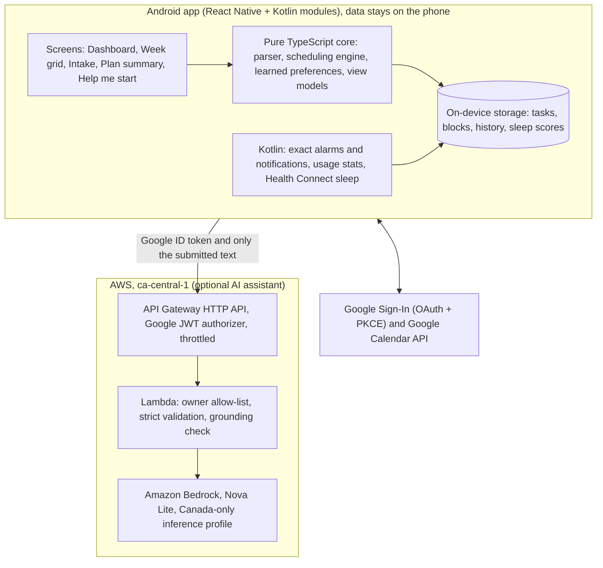

# TimeBlocker

An Android app that turns a plain-text weekly task list into Google Calendar time blocks, learns when you actually get things done, and helps you start the hard ones with a private, Canada-hosted AI assistant.

> **Demo video:** _link coming soon_

Built for one user (me) as a personal productivity tool. Everything except the optional AI assistant runs on the phone.

## What it does

- **Type your week, get a calendar.** Paste a list like `Gym 3x`, `Report due Friday 5pm`, `Dentist Tuesday 3pm`, or `Study 10 hours`. A rule-based parser reads counts, durations, dates, times, and deadlines, then schedules each task as a Google Calendar block. Long totals are split into sessions spread across days. Lines about sleep are skipped because sleep time is protected.
- **Learned placement.** From the last 26 weeks of finished, partial, missed, and skipped blocks, the planner works out, per category and 2-hour slot, how often you complete that kind of task. It then places new tasks where you are most likely to finish them. Durations also come from how long similar tasks really took.
- **Reminders that ask before you slip.** Heads-up notifications 15 minutes before a block include an attendance forecast based on meeting overlaps, your history, and recent distraction-app use. Two actions are offered: "I'll be there" or "Move to later this week". A "Will you miss this block?" prompt appears when a meeting lands on a block.
- **Edit and reschedule.** Tap any planned task to change its day, time, or length. Tasks that clash move to the nearest free slot, and a 10-second undo restores everything.
- **Dashboard.** Shows the share of tasks completed, a sleep score (Samsung Health sleep from Health Connect, plus phone use during sleep), a fitness score, moved tasks, and upcoming hard deadlines.
- **AI assistant (optional, off by default).**
  - *Smarter list reading:* the model only suggests a category and a task kind. Dates and durations always come from the deterministic parser.
  - *Help me start:* for job applications, talking points plus a draft answer that are checked against your own background (see [AI design](#ai-design)). It also drafts short emails and study plans.
- **Also:** light and dark themes, holidays from Google's public holiday calendar, two-way Google Calendar sync of the current and next week, and debug-only demo data for testing.

## Architecture

## Tech stack

| Area | Technology |
|---|---|
| Mobile | React Native 0.88 (New Architecture, Hermes), TypeScript, React Navigation |
| Native Android | Kotlin modules: AlarmManager notifications with Headless JS actions, UsageStatsManager, Health Connect (`SleepSessionRecord`) |
| Core logic | Framework-free TypeScript packages for parsing, scheduling, sync, and view models |
| Integrations | Google Calendar API, Google OAuth (AppAuth, PKCE, no client secret), Android Keystore for tokens |
| AI backend | AWS CDK, API Gateway HTTP API + JWT authorizer, Lambda (Node.js 22, arm64), Amazon Bedrock Converse API with tool-use schemas |
| Ops | AWS Budgets alert, CloudWatch alarms, scoped IAM role behind MFA for deploys |
| Testing | Vitest, fast-check property tests, Jest + React Native Testing Library, CDK assertions |

## AI design

The model is treated as untrusted. It never decides anything that must be exact.

- **Narrow job.** For list reading, the model returns only `category` and `kind` through a forced tool-use JSON schema. The server and the app both validate the reply. Dates, times, deadlines, counts, and durations always come from the deterministic parser.
- **Grounded application help.** In testing, the model invented experience the user didn't have. So every talking point must carry a verbatim quote from the user's own background, and the server checks that the quote really appears there. Points that fail are dropped and replaced with "Add your own example for: ..." prompts. The draft is then written from the verified points only, capped at 120 words, and labelled as a draft to check.
- **Data minimization.** Only the text submitted for that request is sent, never phone usage, sleep, calendar events, or tokens. Request and response text is never logged. Logs hold route, status, latency, and token counts only.
- **Fails closed, degrades gracefully.** The assistant is off by default. If it is unreachable, rejected, slow, or returns an invalid reply, the app silently falls back to the built-in parser.

## Security and privacy

- **Single user.** API Gateway verifies the Google ID token (issuer and audience), and the Lambda accepts only allow-listed Google account IDs. Anyone else is refused before the model is called.
- **Cost and abuse limits.** Stage throttling (2 requests per second, burst 5), request size caps, a fixed `maxTokens` on every model call, a 5 USD monthly budget alert, and error and usage alarms.
- **Least privilege.** The Lambda role can invoke one model through one Canada-only inference profile. Deploys go through a dedicated role that can only be assumed with MFA and cannot create users or keys.
- **On the phone.** OAuth tokens live in Android Keystore-backed storage. Raw usage data never leaves the device. The release build is not debuggable, allows no cleartext traffic, has backups disabled, and is signed with a personal key kept outside the repo.

## Engineering

- **About 2,300 automated tests** across 8 packages, including property-based tests for the scheduler, parser, and sync, screen tests, and CDK template assertions. Guard tests keep only Google and the owner's API host allowed as network hosts, and stop hard-coded colors in screens.
- **Spec-driven.** Requirements (EARS style), design, and task plans are in [`.kiro/specs/timeblocker`](.kiro/specs/timeblocker). The project was built with Kiro, an AI-assisted development environment.

| Package | Purpose |
|---|---|
| `scheduling-engine` | Pure placement engine: free windows, constraints, fixed times, deadlines, scored preferences |
| `flows` | Intake parsing (counts, durations, dates, deadlines), planning, rescheduling, learned preferences |
| `app-core` | On-device services: auth, sync, notifications, planning, dashboard, AI client contract |
| `calendar-integration` | Google Calendar client and OAuth token types |
| `reminders`, `usage-metrics` | Reminder rules, usage aggregation, sleep scoring, plus their Kotlin modules |
| `health-sleep` | Kotlin Health Connect module for sleep sessions |
| `mobile` | React Native app, screens, theme, adapters |
| `infra` | AWS CDK: `TimeBlockerAiStack` (AI assistant). `TimeblockerStack` is an earlier backend design kept for reference and is not deployed. |

## Run it yourself

1. **Tests (Node 22.13 or newer, no Android needed).** In each package under `packages/`, run `npm ci`. Then in `packages/mobile`, run `npm run prebundle`. Run `npx vitest run` in the TypeScript packages and `npx jest` in `packages/mobile`.
2. **The app.** Follow [`packages/mobile/README.md`](packages/mobile/README.md): Android Studio setup, creating your own Google Cloud OAuth clients (one per signing key), then build and install.
3. **The AI assistant (optional).** Follow [`packages/infra/ai/README.md`](packages/infra/ai/README.md) to deploy to your own AWS account. Then set `AI_API_BASE_URL` in `packages/mobile/src/config.ts`.

Configuration lives in `packages/mobile/src/config.ts`. This public copy ships with placeholders: no OAuth client IDs, no API address, and no account details.

## Status and limits

- **Built for one person.** It is a working personal project, not a product. Android only. Timezone is fixed to America/Toronto.
- **Productivity impact is modelled, not measured.** Assuming about 1 hour of weekly planning, 20 planned blocks, and 40% of blocks slipping without help, the reminders, learned placement, and AI drafts would save about 4 to 5 hours a week and raise completion from about 60% to about 85%. The dashboard records the real numbers over time.
- **Calendar sync window.** Sync covers the current and next week. Background sync runs about every 30 minutes, subject to Android battery limits.
